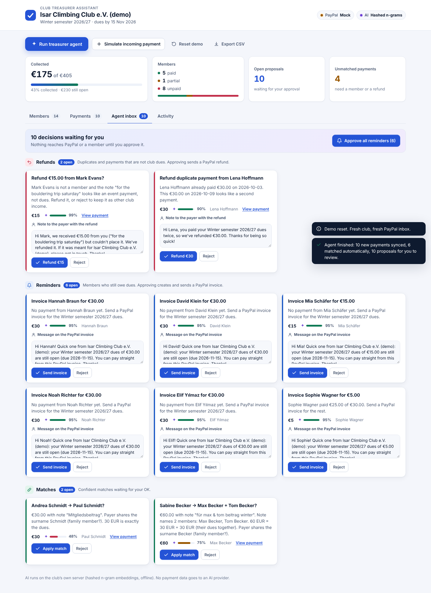
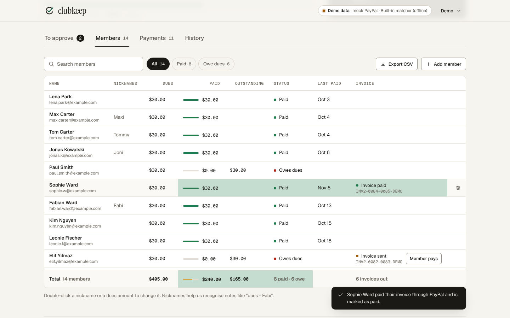
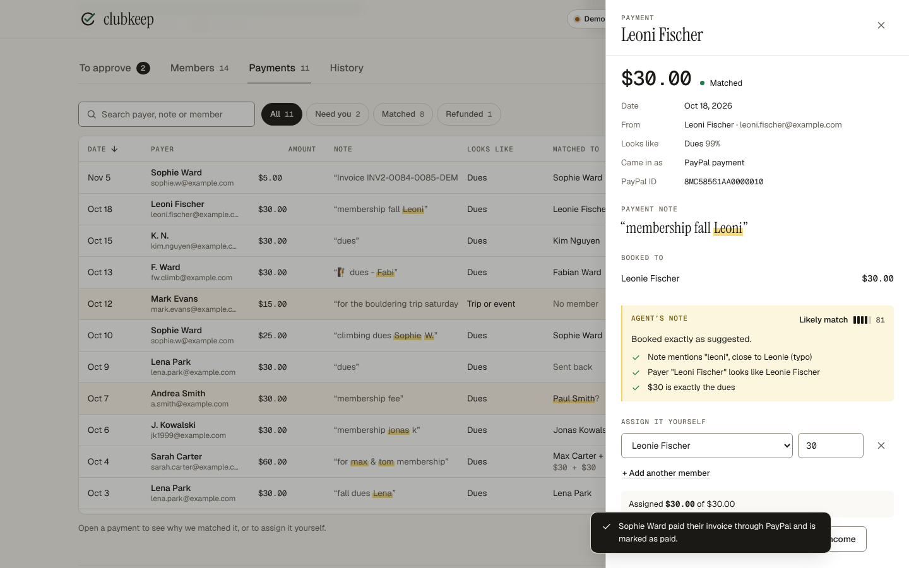
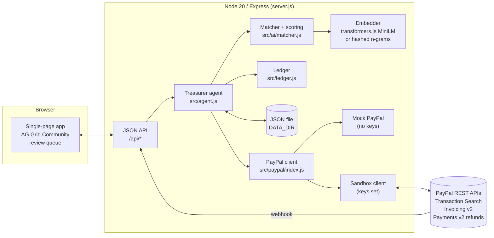

# Clubkeep: the AI treasurer for clubs

Every sports club, student club, choir, hobby group and alumni association has a volunteer treasurer
who collects membership dues. More and more of that money arrives over PayPal, and it arrives messy:
a parent pays for two kids in one transfer with the note "for max & tom membership", someone signs as
"Fabi", someone pays twice, a stranger sends money for a trip. Today the treasurer sorts this out by
hand in a spreadsheet, every season. Clubkeep connects to the club's PayPal account, reads every
incoming payment, works out which member(s) it was for, and turns the leftovers into concrete PayPal
actions: refund the duplicate, invoice the people who haven't paid, remind them later. Confident
matches are applied automatically with the reasons shown; everything that moves money waits for the
treasurer's one-click approval. The AI runs on the club's own server, no paid AI API.

---



| Members (AG Grid) | Why the AI matched a payment |
|---|---|
|  |  |

Demo video (narrated, with captions): [`video/demo.mp4`](video/demo.mp4), recorded with `video/record.mjs`.

## Try it

**Hosted demo:** `https://clubkeep.onrender.com` **[TODO: confirm URL after first Render deploy]**
(Render free tier: the first request after idle can take ~30-60 s while the instance wakes up.)

**Run locally** (Node 20+):

```bash
npm install
npm start
# open http://localhost:3000
```

With no environment variables set, the app runs against a mock PayPal client and the hashed
n-gram embedder, so the full demo works offline and without accounts. Click **Run treasurer
agent** to start.

**Tests:**

```bash
npm test
```

The tests use `node:test` with a fake embedder and the mock PayPal client.

### Demo walkthrough (2 minutes)

The demo club is the fictional **Riverside Climbing Club**: 14 members, dues of $30 for the 2026–27
season ($15 student rate for one member), $405 expected in total, and 10 PayPal payments with
realistic messy notes.

1. **Run treasurer agent**: the 10 payments sync from PayPal and 6 are matched automatically, each
   with its reasons: a nickname ("🧗 dues - Fabi" is Fabian Ward), initials ("membership jonas k"),
   a payer email, a typo ("Leoni" is Leonie Fischer).
2. Open the review queue. Two match proposals: Sarah Carter's $60 "for max & tom membership" split
   across Max and Tom Carter, and Andrea Smith's "membership fee", which probably belongs to Paul Smith
   (same surname, lower confidence). Two refund proposals: Lena Park's second $30 (a duplicate) and
   Mark Evans' $15 "for the bouldering trip saturday" (not a member, not dues). Six invoice reminders,
   including one for the $5 Sophie Ward still owes after paying $25.
3. Approve the refunds: PayPal refunds are issued. Approve the reminders: PayPal invoices are created and sent.
4. **Simulate invoice payment** (demo button): the member's row flips to *Paid*.
5. Export the member list as CSV.

---

## 1. Technological Implementation

**PayPal, end to end, in both directions.** Clubkeep reads money in (Transaction Search),
sends money back (Payments v2 refunds) and asks for money (Invoicing v2 create, send, remind).
A webhook endpoint lets PayPal trigger a sync. All PayPal calls go through one client interface
with two implementations:

- `src/paypal/sandbox.js`: the real client. OAuth2 client-credentials token (cached until expiry),
  Transaction Search, Invoicing v2, Payments v2 refunds, webhook signature verification.
- `src/paypal/mock.js`: an in-memory PayPal with the same methods plus demo helpers
  (simulate a payment, pay an invoice). `src/paypal/index.js` picks the real client when
  `PAYPAL_CLIENT_ID` and `PAYPAL_CLIENT_SECRET` are set, otherwise the mock, so the demo always runs.

**AI that does real work, not a chat box.** The matcher (`src/ai/matcher.js`) turns each payment
into an *allocation*: which member(s), how much each, a confidence score, human-readable reasons
and the runner-up alternatives. It combines:

- a sentence-embedding model run locally with transformers.js (`Xenova/all-MiniLM-L6-v2`) for
  semantic similarity between the payment (note, payer name, payer email) and each member (name,
  nicknames, email), and for the note's intent (dues vs. event vs. donation vs. other);
- a transparent scoring engine on top: name and nickname hits with typo tolerance
  (edit distance with adjacent swaps, so "Leoni" still finds Leonie), initials, exact payer-email
  matches, shared surnames (parents paying), and amount arithmetic ($60 = 2 x $30 dues means look
  for two members).

**An agent loop with a human in it.** `src/agent.js` syncs PayPal, matches, auto-applies matches
above the configurable threshold (default 0.8), and creates proposals for the rest: review a match,
refund a duplicate/overpayment/non-dues payment, remind an unpaid or partially paid member.
Approving a proposal executes the PayPal call; the result (refund ID, invoice ID and status) is
written back to the proposal and the activity log. `src/ledger.js` derives paid / outstanding /
credit / status per member from the allocations, so every number on screen can be traced to payments.

**Small, boring, reliable stack.** Node 20, Express, a JSON file store with atomic writes
(write to temp file, rename), plain-JS frontend, `node:test` tests. Two runtime dependencies:
`express` and `@huggingface/transformers`.

## 2. Design

One screen, built around the treasurer's actual question: *who still owes us money, and what do I
do about it?*

- **Summary:** members, paid / partial / unpaid, expected vs. collected, open proposals.
- **Members grid (AG Grid Community):** status, paid, outstanding, last payment, invoice and reminder
  count. Sortable, filterable, exportable to CSV.
- **Payments grid (AG Grid Community):** every PayPal payment with its note, detected intent,
  matched member(s) and confidence.
- **Review queue:** each proposal has a plain-language title, the reasons, the confidence, and the
  message that will go to the member, editable before you approve. Approve, reject, or approve all
  of one type.
- **Activity log:** every agent decision and PayPal call with its result.

Design rules we held to: the AI always shows *why*; nothing that moves money happens without a click;
a wrong match can be fixed by hand (assign a payment to other members, or ignore it); the app works
the same in mock and sandbox mode, and the screen always says which one you are in.

## 3. Potential Impact

The audience is specific and large: volunteer treasurers of small member organizations anywhere
members pay dues by PayPal. Sports clubs, student clubs, choirs, hobby and community groups, alumni
associations. These are volunteers, usually doing this next to a job or their studies, often handing
the role over every year or two. Small clubs typically don't have accounting software; they have a
PayPal account and a spreadsheet.

What changes for them:

- reconciling a season's dues goes from an evening of cross-referencing to reviewing a handful of
  proposals;
- chasing unpaid members stops being awkward personal messages and becomes a PayPal invoice with a
  pay button, plus a reminder when it's due;
- duplicates and strangers' payments get refunded instead of sitting in the account;
- member data stays on the club's own server in a JSON file, and no third-party AI service sees it,
  which matters for privacy-minded clubs.

> [TODO: add a quote from a real treasurer you talked to, with their permission. Do not invent one.]

## 4. Innovation

Payment reconciliation exists in accounting software, and club-management tools exist, but they
generally assume structured references (an invoice number, a bank reference) and a bookkeeper at
the keyboard. Clubkeep starts from the payments clubs actually get: free-text notes, nicknames,
initials, typos, one payment for several people, parents paying for children. What we think is new:

- **Many-to-many matching from free text.** One payment can be split across members, using names in
  the note, shared surnames and dues arithmetic together.
- **The AI closes the loop through PayPal.** It does not stop at "unmatched": it proposes the refund
  or the invoice, and executes it on approval.
- **Free, local, explainable AI.** A small embedding model running inside the Node process, plus a
  scoring engine whose every point is a sentence on screen. No API bill for a club with $30 dues,
  and no member data leaving the server.

## 5. Presentation

- Demo video (under 3 minutes): **[TODO: YouTube link]**. It is narrated with an AI-generated
  voiceover (made with a free text-to-speech tool) and has captions. The narration script is
  [`docs/VIDEO_SCRIPT.md`](docs/VIDEO_SCRIPT.md). **[TODO: optional shot of the refund and invoices in
  the PayPal sandbox dashboard, once sandbox keys are set.]**
- Pitch: [`docs/PITCH.md`](docs/PITCH.md). Devpost text: [`docs/DEVPOST.md`](docs/DEVPOST.md).
- API contract between backend and frontend: [`docs/API.md`](docs/API.md).
- The hosted demo is seeded with a fictional club so judges can click through the whole flow without accounts.

---

## PayPal APIs used

| Endpoint | What for |
|---|---|
| `POST /v1/oauth2/token` | Client-credentials access token for all other calls (cached until expiry) |
| `GET /v1/reporting/transactions` | Transaction Search: pull incoming payments (payer name, email, amount, note) for the dues period |
| `POST /v2/invoicing/invoices` | Create a dues invoice for an unpaid or partially paid member |
| `POST /v2/invoicing/invoices/{id}/send` | Send that invoice to the member by email |
| `POST /v2/invoicing/invoices/{id}/remind` | Send a reminder for an invoice that is still open |
| `GET /v2/invoicing/invoices` | List invoices (paged) during sync, so a paid invoice marks the member paid |
| `POST /v2/payments/captures/{capture_id}/refund` | Refund a duplicate, an overpayment or a non-dues payment (full or partial) |
| `POST /v1/notifications/verify-webhook-signature` | Verify incoming webhooks when `PAYPAL_WEBHOOK_ID` is set |
| Webhooks -> `POST /api/webhooks/paypal` | PayPal notifies the app (e.g. payment or invoice events); the app verifies and runs a sync |

All calls go to `https://api-m.sandbox.paypal.com` for this entry.

## AI used and how (Tools)

| Tool | Used for |
|---|---|
| [transformers.js](https://github.com/huggingface/transformers.js) (`@huggingface/transformers`) | Runs the embedding model inside Node, on CPU, no external service |
| `Xenova/all-MiniLM-L6-v2` | English sentence embeddings: similarity between a payment (note, payer name, email) and each member (name, nicknames, email); intent of the note (dues / event / donation / other) by nearest-prototype similarity to English example phrases, with keyword evidence on top for very short notes (`src/ai/intent.js`) |
| Scoring engine (our code, `src/ai/matcher.js`) | Combines embedding similarity with name/nickname matches (typo-tolerant), initials, payer email, shared surname, and amount arithmetic into a confidence score with reasons and alternatives; decides splits across members |
| Hashed character n-gram embedder (our code) | Fallback when the model can't be downloaded or `AI_MODE=hashed`; also used by the tests for deterministic, offline runs |
| Treasurer agent (our code, `src/agent.js`) | Sync -> match -> auto-apply above threshold -> propose refunds/reminders -> execute approved PayPal actions |
| Text-to-speech tool (demo video only) | The video's narration is a synthetic voiceover. **[TODO: name the text-to-speech tool used.]** |

No paid or hosted AI API is used. The quantized model (about 23 MB) is downloaded from the Hugging Face
Hub on first use and cached. It was chosen to fit comfortably in the 512 MB of Render's free instance.
Until it has loaded (or if it can't load: no network, too little memory) the hashed embedder is used, so
the app never blocks on the model.

AI coding assistants were also used while building the project. **[TODO: confirm which assistants
were used and state them here, as the rules ask for the tools used.]**

## Architecture



Code layout:

```
server.js               Express: JSON API + static frontend
src/paypal/index.js     picks real or mock client from env
src/paypal/sandbox.js   OAuth, Transaction Search, Invoicing v2, Payments v2 refunds, webhook verify
src/paypal/mock.js      in-memory PayPal with the same methods + demo helpers
src/ai/embedder.js      transformers.js embedder, hashed n-gram fallback
src/ai/matcher.js       payment -> member allocation with confidence, reasons, alternatives
src/ai/intent.js        note intent: dues / event / donation / other
src/agent.js            sync, match, detect duplicates/overpayments/strangers, plan reminders, execute approvals
src/ledger.js           per-member paid / outstanding / credit / status
src/store.js, seed.js   JSON file store, fictional demo club
public/                 single-page app, AG Grid Community from jsDelivr
test/                   node:test, fake embedder + mock PayPal
docs/                   API contract, pitch, Devpost text, video script
```

## Deploy on Render

The repo includes `render.yaml` (Blueprint).

1. Push the repo to GitHub.
2. In the Render dashboard choose **New > Blueprint** and select the repo. Render reads `render.yaml`
   and creates a free web service (`npm install` / `npm start`).
3. Set the environment variables below in the service settings. Leave the PayPal ones empty to run
   the public demo in mock mode.
4. Deploy, then open the service URL. The first request after the instance sleeps takes a while
   (free tier spin-up, plus the ~23 MB model download on the first AI run in `local` mode). The model
   and the app together stay well inside the free instance's 512 MB of memory.
5. Optional: in the PayPal developer dashboard add a webhook pointing at
   `https://<your-service>.onrender.com/api/webhooks/paypal` and put its ID in `PAYPAL_WEBHOOK_ID`.

The free tier has no persistent disk: the JSON file is reset when the instance restarts, and the
demo club is reseeded. For a real club, attach a disk (paid) and point `DATA_DIR` at it, or run it
on the club's own server.

## Environment variables

| Variable | Default | Meaning |
|---|---|---|
| `PAYPAL_CLIENT_ID` | unset | Sandbox REST app client ID. With both PayPal keys set, the app uses the real sandbox; otherwise the mock |
| `PAYPAL_CLIENT_SECRET` | unset | Sandbox REST app secret |
| `PAYPAL_WEBHOOK_ID` | unset | Webhook ID from the developer dashboard. With the sandbox client, webhooks are only accepted when it is set and PayPal verifies the signature |
| `ADMIN_TOKEN` | unset | When set, all write endpoints need the header `x-admin-token`; the UI asks for it once |
| `AI_MODE` | `local` | `local` = transformers.js model, `hashed` = hashed n-gram embedder (no download) |
| `EMBED_MODEL` | `Xenova/all-MiniLM-L6-v2` | Hugging Face model ID for `AI_MODE=local`. The default (~23 MB quantized) fits Render's free 512 MB instance; a larger model may not |
| `DATA_DIR` | `./data` | Where the JSON data file lives |
| `PORT` | `3000` | HTTP port (Render sets it automatically) |
| `PAYPAL_API_BASE` | `https://api-m.sandbox.paypal.com` | Optional override of the PayPal API base URL |

Never commit keys. `.env` files are git-ignored.

## Sandbox setup

1. Log in at [developer.paypal.com](https://developer.paypal.com) and open **Apps & Credentials**
   (Sandbox).
2. Create a REST app. Copy its client ID and secret into `PAYPAL_CLIENT_ID` / `PAYPAL_CLIENT_SECRET`.
3. Under **Sandbox accounts** use (or create) a **business** account (the club) and one or more
   **personal** accounts (members). Log in to [sandbox.paypal.com](https://www.sandbox.paypal.com)
   as a personal account and send money to the business account with a note like
   "for max & tom membership" to create realistic test payments.
4. In the app's settings, make sure **Transaction Search** and **Invoicing** are enabled as features.
5. Note that Transaction Search is not real-time: new transactions can take a while to show up
   (PayPal's docs mention up to about three hours). For a live demo, send the test payments well
   in advance. The webhook path triggers a sync but the data still comes from Transaction Search.
   Invoices are the exception: once PayPal reports an invoice as PAID, the app books it for that
   member right away, without waiting for the transaction to appear.
6. To see the results of the agent's actions, log in to the sandbox business account:
   refunds appear in the activity list, invoices under Invoicing.

## Limitations and honest notes

- **Sandbox only.** This entry has only been run against the PayPal sandbox and the mock.
- **The hosted demo runs on the mock** unless sandbox keys are configured there, so judges can click
  everything without accounts. The mock mirrors the real client's interface; it does not reproduce
  every PayPal edge case.
- **Transaction Search lag** (see above) means a payment can take time to appear in sandbox mode.
- **Matching is not perfect.** It is tuned on the fictional demo club and a set of test cases, not on
  real club data. That's why anything below the confidence threshold goes to review, and every match
  can be corrected by hand.
- **English notes work best.** The default model is an English embedding model. Names, emails, initials
  and amounts are matched by the scoring engine regardless of language, but the intent of a note in
  another language is less reliable.
- **Refunds need a capture ID.** Payments received as plain PayPal transfers may not be refundable
  through the Payments v2 captures endpoint in every case; failed refunds are shown as failed
  proposals with PayPal's error, not hidden.
- **One club, one period, one dues amount per member.** No multi-club tenancy, no installments,
  no bank transfers or direct debit yet.
- **Storage is a JSON file.** Fine for a club of a few hundred members, not built for more.
- **No real users yet.** **[TODO: if you talk to treasurers before submitting, summarize what they said here.]**

## Roadmap

- Bank-transfer import (statement CSV) next to PayPal, since many clubs get dues both ways.
- PayPal Subscriptions for recurring dues, so the matching problem shrinks for new members.
- Learning from corrections: a treasurer's manual assignment becomes a remembered alias.
- Payouts for reimbursing members' expenses (trip fuel, equipment).
- Handover mode: a clean report for the next treasurer and the annual audit.
- Other languages, in the interface and through a multilingual embedding model for clubs that need one.

## License

[MIT](LICENSE)
